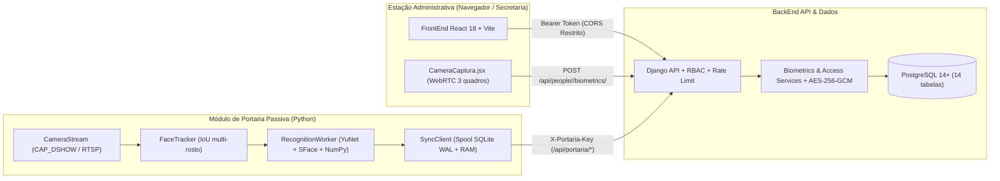

# Reconhece+ v2.0 — Sistema Comercial de Monitoramento Escolar por Reconhecimento Facial

Plataforma completa de controle de presença e monitoramento de acesso escolar desenvolvida em arquitetura desacoplada para uso institucional e comercial — separando a **Estação Web de Cadastro Biométrico**, o **Back-End Seguro em Django + PostgreSQL** (com criptografia **AES-256-GCM** e auditoria LGPD) e o **Módulo Autônomo e Passivo de Portaria** em OpenCV (YuNet + SFace ONNX).

---

## Visão Geral da Versão 2.0

A v2.0 foi reestruturada para operação contínua em produção:

1. **Separação clara entre Câmera de Registro e Câmera da Portaria**:
   - **Câmera de Registro (Painel Web / `CameraCaptura.jsx` ou `portaria/cadastrar_rosto.py`)**: dedicada ao cadastro. Captura 3 quadros nítidos, valida rosto único/enquadramento/nitidez/consistência no servidor, extrai o vetor 128-d SFace em memória e salva apenas o vetor **criptografado em AES-256-GCM** no PostgreSQL (**zero fotos salvas em disco**).
   - **Módulo de Portaria Passivo (`portaria/reconhecimento.py`)**: roda no totem/computador da entrada da escola com pipeline multi-thread de alta velocidade. Capta alunos e funcionários continuamente em movimento, **não exige autorização manual e nunca bloqueia passagens** — apenas identifica, alterna automaticamente **Entrada ↔ Saída** e emite avisos/alertas em tempo real.
2. **Segurança e Conformidade LGPD**:
   - Autenticação real via **Bearer Token (`AuthToken` com hash SHA-256 e TTL)** + sessões Django, controle de acesso por papéis (**RBAC**: `admin`, `coordenacao`, `secretaria`, `visualizador`) e proteção contra força bruta (rate limiting de 5 tentativas em 5 min).
   - Terminais da portaria autenticam exclusivamente via chave própria por dispositivo (`X-Portaria-Key` com rotação no painel).
   - Vetores biométricos (128-d) criptografados com **AES-256-GCM** + chaves derivadas por **HKDF-SHA256** e **AAD** vinculada ao titular (`aluno:<id>` / `funcionario:<id>`).
   - Dados de responsáveis (CPF e telefone) protegidos com criptografia autenticada e índice cego **HMAC-SHA256** (`cpf_hash`).
   - Registro explícito de consentimento LGPD, botão de revogação biométrica imediata e trilha completa em `log_auditoria`.

---

## Arquitetura do Sistema



---

## Fluxo Passivo Automático da Portaria

O motor de regras (`BackEnd/core/services/access_service.py`) processa cada passagem recebida de forma não-bloqueante:

- **Idempotência**: cada evento gera `clientEventId` único; reenvios da fila offline (`portaria/spool.db`) não duplicam registros.
- **Cooldown anti-duplicidade**: ignora leituras repetidas da mesma pessoa dentro de `cooldown_segundos` (padrão `45s`).
- **Entrada / Saída Automática (`modo = auto`)**:
  - Primeira passagem do dia (ou após uma saída): registra **`entrada`**. Se após o horário limite do turno, marca status **`atraso`** e gera aviso/alerta.
  - Passagem seguinte após `tempo_minimo_permanencia_min` (padrão `2 min`): registra **`saida`**. Para alunos que saem antes de `limite_saida_antecipada`, marca **`saida-antecipada`** e gera aviso/alerta.
- **Cadastro inativo ou rosto desconhecido**: registra passagem com `incidente = True` e emite aviso discreto no HUD da portaria + alerta de severidade alta para a coordenação.

---

## Tecnologias

| Camada | Tecnologias |
|---|---|
| **Front-end** | React 18, Vite 5, Tailwind CSS 4, WebRTC (`getUserMedia`) |
| **Back-end** | Python 3.12, Django 5, `psycopg` (v3), `django-cors-headers`, `cryptography` (AES-256-GCM / HKDF / HMAC) |
| **Banco de dados** | PostgreSQL 14+ (exclusivo, sem SQLite no servidor; índices `pg_trgm`, parciais e compostos) |
| **Performance Web** | Paginação e filtros server-side (`/api/people/`, `/api/logs/`, `/api/alerts/`, `/api/audit/`), agregações SQL (`DISTINCT ON`, `TruncDate`) e polling incremental leve `/api/live/` |
| **Visão Computacional** | OpenCV 5 (`cv2.FaceDetectorYN` YuNet + `cv2.FaceRecognizerSF` SFace ONNX) + matching vetorizado NumPy |
| **Resiliência Offline** | Fila local SQLite em modo WAL (`portaria/spool.db`) para eventos de portaria |

---

## Estrutura do Repositório

```text
.
├── BackEnd/
│   ├── core/
│   │   ├── crypto/              # AES-256-GCM, HKDF-SHA256, HMAC blind index e mascaramento
│   │   ├── management/commands/ # seed_mock.py (usuários RBAC, turnos, câmeras e histórico)
│   │   ├── middleware/          # audit.py (Request ID, Client IP, Cache-Control, JSON 500)
│   │   ├── migrations/          # Histórico completo (0001 a 0007 com pg_trgm e índices parciais)
│   │   ├── services/            # biometrics.py (YuNet/SFace + AES) e access_service.py (fluxo passivo)
│   │   ├── tests/               # Suíte automatizada (cripto/segurança, serviços, API/RBAC, implantação)
│   │   ├── models.py            # 14 modelos relacionais + constraints e índices
│   │   ├── security.py          # AuthToken, RBAC, X-Portaria-Key, rate limiting e auditoria
│   │   └── views.py             # Endpoints REST v2.0 + /api/portaria/*
│   ├── school_api/              # settings.py, urls.py, wsgi.py
│   ├── .env.example
│   └── requirements.txt
├── FrontEnd/
│   └── src/
│       ├── __tests__/           # Testes Vitest + Testing Library (utils, api, componentes, páginas)
│       ├── components/          # CameraCaptura.jsx (estação web), ErrorBoundary, PaginationBar, Pills
│       ├── lib/                 # api.js (Bearer token em sessionStorage + handler 401)
│       └── pages/               # Login, Dashboard, Alunos, Funcionários, Cadastro, Perfil, Monitoramento, Alertas, Relatórios, Configurações
├── portaria/
│   ├── tests/                   # Testes unitários offline (tracker, engine, spool SQLite WAL, HUD)
│   ├── camera.py                # CameraStream em thread dedicada (CAP_DSHOW / MJPG / RTSP)
│   ├── tracker.py               # FaceTracker multi-rosto por IoU e centróide
│   ├── engine.py                # RecognitionWorker (YuNet redimensionado + matching NumPy)
│   ├── sync_client.py           # SyncClient (spool SQLite WAL, hot-reload RAM, heartbeat)
│   ├── hud.py                   # HudRenderer passivo com avisos não-bloqueantes
│   ├── reconhecimento.py        # Orquestrador principal da portaria (--source, --modo, --headless, --demo)
│   ├── cadastrar_rosto.py       # Estação CLI alternativa para cadastro facial na API
│   └── .env.example
├── docs/                        # Documentação técnica modular completa (01 a 08)
├── scripts/                     # run_all_tests.ps1 e smoke_deploy.py
├── banco.sql                    # Referência DDL completa do PostgreSQL v2.0
└── README.md
```

---

## Como Executar

### Pré-requisitos
- Python 3.11 ou 3.12
- Node.js 18+
- PostgreSQL 14+ com banco `escola` criado (`CREATE DATABASE escola;`)
- Webcam ou câmera IP RTSP (para cadastro e portaria)

### 1. Back-end (Django + PostgreSQL)

```bash
cd BackEnd
python -m venv venv
.\venv\Scripts\activate            # Linux/macOS: source venv/bin/activate
pip install -r requirements.txt
copy .env.example .env             # Configure DATABASE_URL, BIOMETRIC_MASTER_KEY e PORTARIA_DEV_KEY
python manage.py migrate
python manage.py seed_mock
python manage.py runserver
```

> **Credenciais iniciais criadas pelo `seed_mock` (apenas desenvolvimento):**
> - **Admin:** `admin@escola.edu.br` / `Admin@2026`
> - **Coordenação:** `coordenacao@escola.edu.br` / `Coord@2026`
> - **Secretaria:** `secretaria@escola.edu.br` / `Sec@2026`

### 2. Front-end (Painel Web + Câmera de Registro)

```bash
cd FrontEnd
npm install
npm run dev
```

Acesse `http://localhost:5173` (para apontar para outro servidor, crie `FrontEnd/.env` com `VITE_API_URL=http://servidor:8000/api`).

### 3. Módulo de Portaria Passivo

```bash
cd portaria
copy .env.example .env             # Informe a PORTARIA_DEVICE_KEY (X-Portaria-Key) do dispositivo
..\BackEnd\venv\Scripts\python.exe reconhecimento.py
```

Parâmetros opcionais úteis:
- `--source 0` (webcam), `--source rtsp://...` (câmera IP) ou `--source video.mp4`
- `--portal "Portaria principal"`
- `--modo auto|entrada|saida`
- `--headless` (roda sem interface gráfica, ideal para mini-PC/totem)
- `--demo` (simulação interativa via terminal sem câmera)

---

## Verificações e Testes

O projeto possui uma suíte automatizada em 6 camadas (unitários, integração, interface, portaria offline e smoke test HTTP de implantação) + pipeline CI em `.github/workflows/ci.yml`. Veja detalhes completos em [08 — Testes e CI/CD](docs/08-testes-ci.md).

---

## Documentação Completa (`docs/`)

Para documentação técnica detalhada por módulo, acesse o índice em [docs/README.md](docs/README.md):

| Guia | Descrição |
|---|---|
| [01 — Arquitetura do Sistema](docs/01-arquitetura.md) | Subsistemas desacoplados, diagramas de fluxo e decisões arquiteturais |
| [02 — Banco de Dados](docs/02-banco-de-dados.md) | Diagrama ER, 14 tabelas, constraints, `pg_trgm`, 30 índices e backup |
| [03 — Referência da API REST](docs/03-api-referencia.md) | 27 endpoints HTTP, matriz RBAC, paginação e payloads JSON |
| [04 — Segurança e LGPD](docs/04-seguranca-lgpd.md) | HKDF-SHA256, AES-256-GCM + AAD, rotação de chaves, tokens e auditoria |
| [05 — Módulo de Portaria e Biometria](docs/05-modulo-portaria.md) | Pipeline OpenCV 5 (YuNet + SFace), tracker IoU, spool WAL e CLI |
| [06 — Guia do Front-end](docs/06-frontend-guia.md) | React 18 + Vite, `api.js`, polling `/api/live/`, webcam WebRTC e `ErrorBoundary` |
| [07 — Instalação e Implantação](docs/07-instalacao-implantacao.md) | Setup Windows/Linux, variáveis `.env`, checklist de produção e troubleshooting |
| [08 — Testes e CI/CD](docs/08-testes-ci.md) | 6 camadas automatizadas (61 testes + build + smoke HTTP) e GitHub Actions |

### Rodar tudo de uma vez (Windows PowerShell)

```powershell
.\scripts\run_all_tests.ps1
```

### Rodar cada camada separadamente

```powershell
# 1. BackEnd — Unitários (criptografia AES-256-GCM, serviços), Integração (API/RBAC) e Implantação (migrations, índices pg_trgm, seed_mock idempotente)
cd BackEnd
.\venv\Scripts\python.exe manage.py check
.\venv\Scripts\python.exe manage.py makemigrations core --check --dry-run
.\venv\Scripts\python.exe manage.py test core --verbosity=2

# 2. Portaria — Tracker multi-rosto, matching vetorizado, fila offline SQLite WAL e HUD
cd ..
.\BackEnd\venv\Scripts\python.exe -m unittest discover -s portaria/tests -t . -v

# 3. FrontEnd — Testes unitários/componentes/páginas (Vitest + Testing Library) e build de produção
cd FrontEnd
npm test
npm run build

# 4. Implantação — Smoke test HTTP ponta a ponta contra o PostgreSQL
cd ..
.\BackEnd\venv\Scripts\python.exe .\scripts\smoke_deploy.py
```

---

## Segurança em Produção

Antes de publicar em ambiente real:
1. Defina `DJANGO_DEBUG=0`, uma `DJANGO_SECRET_KEY` forte (>= 32 caracteres) e gere `BIOMETRIC_MASTER_KEY` exclusiva com:
   ```bash
   python -c "import os,base64; print(base64.urlsafe_b64encode(os.urandom(32)).decode())"
   ```
2. Restrinja `DJANGO_ALLOWED_HOSTS` e `FRONTEND_ORIGINS` aos domínios HTTPS reais da escola.
3. Cadastre cada câmera em **Configurações → Câmeras de portaria** para gerar chaves `X-Portaria-Key` individuais e remova/altere as contas de desenvolvimento do `seed_mock`.
4. Leia sempre a política de proteção de dados da **Lei nº 13.709/2018 (LGPD)**: coleta mediante consentimento do responsável, armazenamento apenas do vetor matemático criptografado (nunca da fotografia), auditoria de acesso e revogação imediata quando solicitada.

---

## Licença

Projeto acadêmico e comercial desenvolvido no curso de Engenharia de Software da UNISATC.
