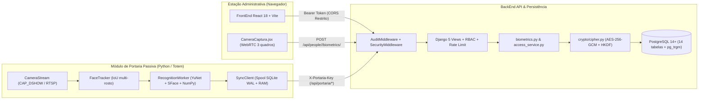
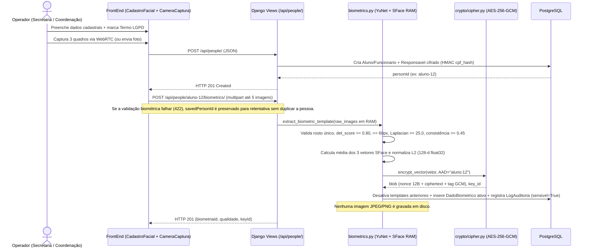
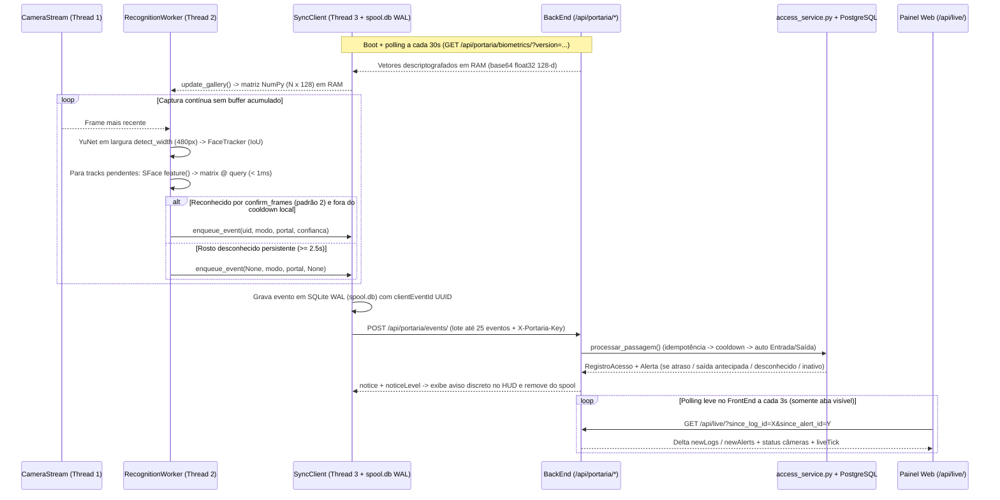

# 01 — Arquitetura do Sistema

O **Reconhece+ v2.0** foi projetado como uma plataforma desacoplada em três subsistemas independentes que se comunicam exclusivamente via HTTP/JSON sobre API REST autenticada, permitindo escalar o painel web, o servidor central e múltiplos terminais físicos de portaria sem acoplamento de código ou banco compartilhado em rede local.

---

## Visão Macro dos Subsistemas

### Papéis de cada componente
1. **Estação Web (`FrontEnd/`)**: interface SPA em React 18 para gestão de alunos, funcionários, cadastro biométrico com consentimento LGPD, monitoramento em tempo real, tratamento de alertas, exportação de relatórios CSV, administração de dispositivos de portaria e consulta de auditoria.
2. **Core API & Regras (`BackEnd/`)**: servidor Django 5 sem SQLite (exclusivo **PostgreSQL**), responsável por autenticação (`AuthToken` SHA-256 + sessão Django), autorização por papéis (RBAC), extração e validação biométrica no cadastro, criptografia **AES-256-GCM**, regras passivas de acesso (`access_service.py`), agregações SQL e exposição de `/api/portaria/*`.
3. **Terminal Passivo de Portaria (`portaria/`)**: processo Python multi-thread projetado para rodar localmente junto à câmera da entrada/saída (webcam USB ou stream RTSP IP). Opera em alta taxa de quadros com detecção redimensionada, rastreamento multi-rosto e matching vetorizado em memória RAM — continuando operacional mesmo se a rede com o servidor cair temporariamente.

---

## Fluxo 1 — Estação de Cadastro Biométrico

Diferentemente da portaria, o cadastro exige qualidade rigorosa e consentimento expresso antes de gerar o template biométrico oficial:

---

## Fluxo 2 — Portaria Passiva em Tempo Real

Na portaria da escola, o fluxo nunca bloqueia passagens nem pede confirmação humana:

---

## Principais Decisões Arquiteturais

### 1. Separação estrita entre Estação de Registro e Portaria
- **Por quê**: a estação de cadastro precisa exigir rosto único, imóvel, nítido e bem iluminado (3 quadros com consistência matemática verificada no servidor). Já a portaria precisa processar múltiplos alunos caminhando simultaneamente em 30 FPS com baixa latência, sem travar caso uma pessoa passe rápido.
- **Resultado**: cada ambiente tem sua própria câmera, algoritmo de validação, forma de autenticação (`Bearer Token` humano vs. `X-Portaria-Key` de máquina) e interface visual.

### 2. PostgreSQL exclusivo no servidor e zero SQLite em produção
- O servidor BackEnd (`BackEnd/school_api/settings.py`) utiliza exclusivamente `django.db.backends.postgresql`, garantindo integridade referencial forte (`CHECK constraints`), tipos nativos (`INET`, `JSONB`, `BYTEA`), extensão `pg_trgm` para buscas parciais indexadas e `DISTINCT ON` para cálculo instantâneo de quem está dentro da escola.
- O único SQLite existente no projeto fica **isolado no terminal de campo (`portaria/spool.db`)**, em modo `WAL`, atuando exclusivamente como buffer offline temporário caso o totem perca internet/Wi-Fi.

### 3. Privacidade by Design (Zero Fotos em Disco)
- Imagens capturadas na estação de registro são decodificadas e descartadas em memória RAM após extração do embedding SFace de 128 dimensões.
- No módulo de portaria, os quadros da webcam também trafegam apenas em RAM para extração de características e comparação contra a matriz NumPy carregada via API.

### 4. Escalabilidade de Consultas e Tempo Real Leve
- **Paginação server-side**: todas as listagens potencialmente grandes (`/api/people/`, `/api/logs/`, `/api/alerts/`, `/api/audit/`, histórico em `/api/people/<ref>/`) paginam no PostgreSQL com limites configuráveis (`page_size` até `100`).
- **Sync incremental (`/api/live/`)**: em vez de recarregar o banco inteiro a cada atualização, o FrontEnd envia `since_log_id` e `since_alert_id`. Quando não há eventos novos, a API responde com `changed: false` em ~250 bytes, e o polling pausa automaticamente quando a aba do navegador está em segundo plano (`document.visibilityState`).
