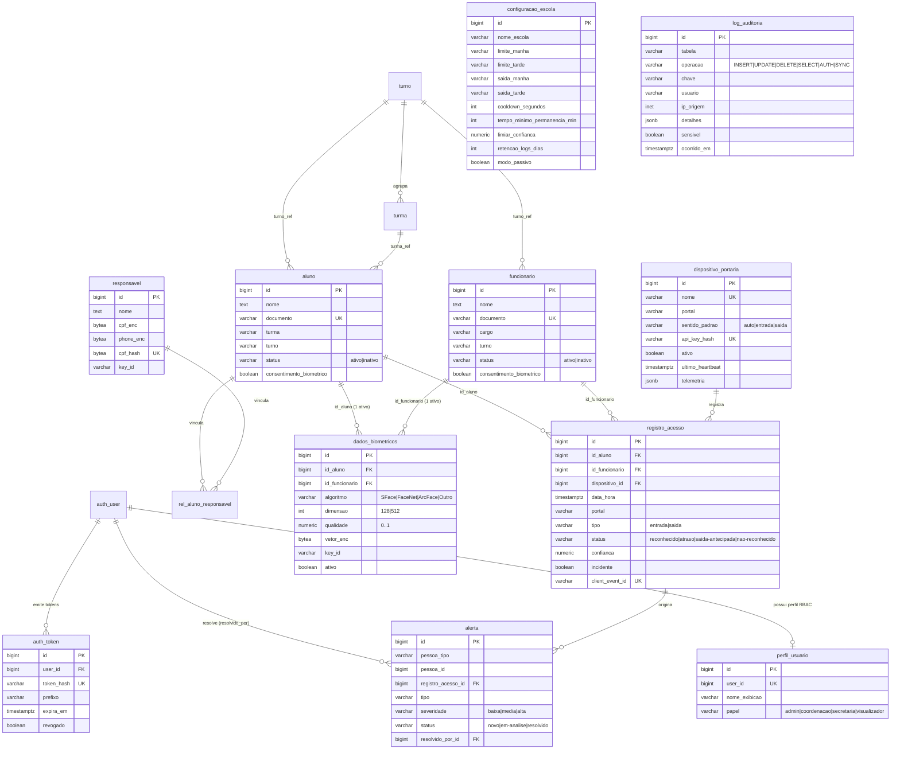

# 02 — Banco de Dados (PostgreSQL 14+)

O banco de dados oficial do **Reconhece+ v2.0** é o **PostgreSQL 14 ou superior**, gerenciado via Django ORM (`BackEnd/core/models.py`) e migrations versionadas (`0001` a `0007`), com referência DDL completa documentada em [banco.sql](../banco.sql).

---

## Diagrama Entidade-Relacionamento (ER)



---

## Catálogo das 14 Tabelas

| Tabela | Classe Django | Finalidade e Constraints Relevantes |
|---|---|---|
| `perfil_usuario` | `PerfilUsuario` | Estende `auth_user` (`OneToOne`, `CASCADE`) com `nome_exibicao` e `papel` (`CHECK`: `admin`, `coordenacao`, `secretaria`, `visualizador`). |
| `auth_token` | `AuthToken` | Armazena apenas o hash **SHA-256** do Bearer Token (`token_hash` único), `prefixo`, `expira_em`, `ultimo_uso_em`, `ip_origem` e `revogado`. |
| `configuracao_escola` | `ConfiguracaoEscola` | Parâmetros globais da escola: horários limite, `cooldown_segundos` (`5..600`), `tempo_minimo_permanencia_min` (`1..120`), `limiar_confianca` (`0.250..0.850`), `retencao_logs_dias` (`30..3650`) e flags de notificação. |
| `dispositivo_portaria` | `DispositivoPortaria` | Câmeras/terminais físicos com `nome` único, `portal`, `sentido_padrao` (`CHECK`: `auto`, `entrada`, `saida`), `api_key_hash` SHA-256 único, heartbeat e `telemetria` JSONB. |
| `turno` | `Turno` | Turnos letivos (`Manhã`, `Tarde`, `Integral`, etc.) com `inicio`, `limite_entrada`, `termino` e `limite_saida_antecipada`. |
| `turma` | `Turma` | Turmas vinculadas a `Turno` com `on_delete=PROTECT` (impede excluir turno com turmas ativas) e `ano_letivo`. |
| `responsavel` | `Responsavel` | Dados pessoais sensíveis cifrados em `BYTEA` (`cpf_enc`, `email_enc`, `phone_enc`), `key_id` para rotação e índice cego determinístico `cpf_hash` único (`HMAC-SHA256`). |
| `aluno` | `Aluno` | Cadastro estudantil com `documento` único (mín. 3 chars), `turma_ref`/`turno_ref` (`PROTECT`), `status` (`ativo`/`inativo`) e campos de consentimento LGPD. |
| `rel_aluno_responsavel` | `RelAlunoResponsavel` | Tabela associativa N:N entre `aluno` e `responsavel` (`CASCADE`, constraint única `uq_rel_aluno_responsavel`). |
| `funcionario` | `Funcionario` | Professores e equipe escolar com `documento` único, `cargo`, `turno_ref` (`PROTECT`), `status` e consentimento LGPD. |
| `dados_biometricos` | `DadoBiometrico` | Vetor facial cifrado em `vetor_enc` (`BYTEA`), algoritmo (`SFace`), `dimensao` (`128`/`512`), `qualidade` (`0..1`), `key_id` e `ativo`. Constraint `biometria_um_dono` garante vínculo exclusivo a `aluno` **ou** `funcionario`. |
| `registro_acesso` | `RegistroAcesso` | Passagens registradas na portaria. Mantém integridade histórica via `SET NULL`, idempotência via `client_event_id` único e constraint `registro_acesso_uma_pessoa_ou_nao_reconhecido`. |
| `alerta` | `Alerta` | Ocorrências para coordenação (`Atraso na entrada`, `Saída antecipada`, `Tentativa não reconhecida`, `Cadastro inativo na portaria`) com fluxo `novo` → `em-analise` → `resolvido`. |
| `log_auditoria` | `LogAuditoria` | Trilha append-only de auditoria (`INSERT`, `UPDATE`, `DELETE`, `SELECT`, `AUTH`, `SYNC`) com IP, payload JSONB e marcador `sensivel` para eventos LGPD. |

---

## Índices de Desempenho e Extensão `pg_trgm`

Para manter buscas, paginação e agregações rápidas mesmo com milhares de registros diários, a migration `0007` habilita a extensão **`pg_trgm`** e cria **30 índices especializados** (entre `GIN`, parciais `WHERE` e compostos `DESC`):

### 1. Busca textual rápida (`GIN` com `gin_trgm_ops`)
Evita `Sequential Scan` em filtros `icontains` (como `?search=Ana` ou `?search=2026`):
- `aluno_nome_trgm_idx` (`aluno.nome`)
- `aluno_doc_trgm_idx` (`aluno.documento`)
- `func_nome_trgm_idx` (`funcionario.nome`)
- `func_doc_trgm_idx` (`funcionario.documento`)

### 2. Índices parciais para hotspots do sistema
Mantêm os índices pequenos mantendo apenas registros ativos/abertos/sensíveis:
- `auth_token_ativo_hash_idx` — `auth_token (token_hash) WHERE revogado = FALSE`
- `disp_ativo_key_idx` — `dispositivo_portaria (api_key_hash) WHERE ativo = TRUE`
- `bio_aluno_only_ativo_idx` — `dados_biometricos (id_aluno) WHERE ativo = TRUE AND id_aluno IS NOT NULL`
- `bio_func_only_ativo_idx` — `dados_biometricos (id_funcionario) WHERE ativo = TRUE AND id_funcionario IS NOT NULL`
- `acesso_desconhecido_portal_idx` — `registro_acesso (portal, data_hora DESC) WHERE id_aluno IS NULL AND id_funcionario IS NULL` (acelera cooldown de desconhecidos)
- `acesso_incidente_data_idx` — `registro_acesso (data_hora DESC) WHERE incidente = TRUE`
- `alerta_aberto_data_idx` — `alerta (criado_em DESC) WHERE status <> 'resolvido'` (badge de alertas abertos em `live_updates` e `bootstrap`)
- `auditoria_sensivel_idx` — `log_auditoria (ocorrido_em DESC) WHERE sensivel = TRUE`

### 3. Índices compostos e de paginação/ordenação
- `registro_acesso`: `acesso_data_idx`, `acesso_data_id_idx` (`-data_hora, -id` para paginação determinística e `/api/dashboard/`), `acesso_status_data_idx`, `acesso_tipo_data_idx`, `acesso_portal_data_idx`, `acesso_aluno_data_idx`, `acesso_func_data_idx`.
- `aluno` e `funcionario`: `aluno_status_turma_nome_idx`, `aluno_status_turno_idx`, `func_status_cargo_nome_idx`.
- `alerta`: `alerta_status_data_idx`, `alerta_pessoa_data_idx`.
- `log_auditoria`: `auditoria_data_idx`, `auditoria_tabela_op_idx`, `auditoria_usuario_idx`.
- `dados_biometricos` e `auth_token`: `bio_aluno_ativo_idx`, `bio_func_ativo_idx`, `auth_token_user_idx`.

---

## Histórico de Migrations

| Migration | Evolução Aplicada |
|---|---|
| `0001_initial` | Modelos base iniciais (`Aluno`, `Funcionario`, `RegistroAcesso`, `Alerta`). |
| `0002` a `0004` | Ajuste de `data_hora`, colunas legadas `id_aluno`/`id_funcionario`, validadores e primeiras constraints. |
| `0005_turma_turno` | Criação das tabelas normalizadas `Turno` e `Turma` com FKs `PROTECT` em `Aluno`. |
| `0006_authtoken_configuracaoescola_dadobiometrico_and_more` | Evolução v2.0 comercial: `PerfilUsuario`, `AuthToken`, `ConfiguracaoEscola`, `DispositivoPortaria`, `Responsavel`, `RelAlunoResponsavel`, `DadoBiometrico`, `LogAuditoria`, `client_event_id` e consentimento LGPD. |
| `0007_alerta_alerta_aberto_data_idx_and_more` | Extensão `TrigramExtension()` (`pg_trgm`) + criação dos índices `GIN`, parciais e compostos de alta performance. |

> **Observação**: o arquivo [banco.sql](../banco.sql) espelha o schema gerado pelas migrations `0001`–`0007` como documentação DDL, mas o comando oficial de criação/atualização do banco em todos os ambientes é `python manage.py migrate`.

---

## Comandos Úteis de Administração (PostgreSQL)

### Verificar extensão `pg_trgm` e índices ativos
```sql
SELECT extname, extversion FROM pg_extension WHERE extname = 'pg_trgm';

SELECT tablename, indexname
FROM pg_indexes
WHERE schemaname = 'public'
ORDER BY tablename, indexname;
```

### Verificar integridade das migrations via Django
```powershell
cd BackEnd
.\venv\Scripts\python.exe manage.py showmigrations core
.\venv\Scripts\python.exe manage.py makemigrations core --check --dry-run
```

### Backup e Restauração (`pg_dump` / `pg_restore`)
```powershell
# Backup completo compactado (custom format)
pg_dump -U postgres -h localhost -F c -b -v -f "backup_escola_$(Get-Date -Format 'yyyyMMdd_HHmm').dump" escola

# Restauração em banco limpo
createdb -U postgres escola_restaurada
pg_restore -U postgres -h localhost -d escola_restaurada --no-owner -v backup_escola.dump
```
